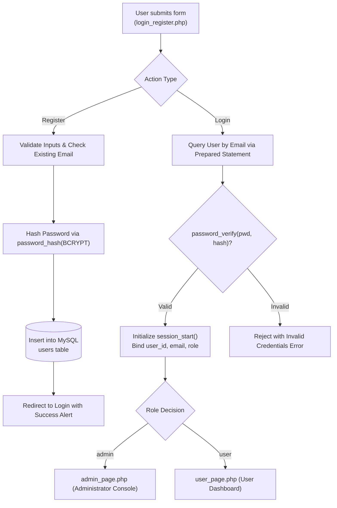

# Secure PHP & MySQL Role-Based Authentication System

<p align="center">
  <strong>Lightweight Role-Based Access Control, BCrypt Password Security, and Session Isolation</strong><br>
  <em>Full-stack PHP/MySQL authentication blueprint featuring dynamic sliding-form UI, dual role gating (Admin vs User), and SQL injection mitigation.</em>
</p>

<p align="center">
  
  
  
  
  
</p>

---

## Overview

**Secure PHP & MySQL Role-Based Authentication System** is a lightweight, educational and production-ready authentication blueprint developed in **PHP**, **MySQL**, **JavaScript (ES6)**, and **CSS3**. Engineered to demonstrate secure user lifecycle management without framework overhead, the system implements salted **BCrypt** password hashing, role-based access redirection (`admin` vs. `user`), and hardened session state isolation.

Unlike primitive tutorial scripts that store plaintext passwords or use vulnerable string concatenations, this repository provides a secure reference architecture: inputs are validated and sanitized, SQL queries use parameterized prepared statements, and session cookies are cleared upon logout.

---

## The Web Authentication Vulnerability Problem & The Secure PHP Solution

### The Challenge
- **Plaintext & Weak Hashing (MD5/SHA1):** Legacy web applications continue to store unsalted MD5 or SHA1 password hashes, leaving user credentials vulnerable to rainbow table attacks.
- **Missing Role Gating:** Insecure authorization checks allow standard users to access administrator consoles simply by guessing direct URL paths (e.g., `/admin_page.php`).
- **SQL Injection Vulnerabilities:** Direct variable interpolation in SQL queries exposes relational databases to authentication bypass (`' OR '1'='1`).
- **Jarring Page Reloads:** Traditional PHP authentication forms require full page redirects between sign-in and registration, creating high friction for end users.

### The Secure PHP Solution
- **Native BCrypt Cryptographic Hashing:** Uses PHP's `password_hash()` with adaptive cost factors and automatic random salting, verified via `password_verify()`.
- **Enforced Session-Level RBAC:** Every protected endpoint validates `$_SESSION['role']` at the start of execution; unauthorized roles are immediately rejected and redirected.
- **Parameterized Query Invariant:** All SQL lookups use MySQLi prepared statements to eliminate SQL injection attack vectors.
- **Fluid Sliding Form UI:** Client-side CSS3 transitions toggle smoothly between Sign In and Registration panels without refreshing the page.

---

## Application Screenshots

All screenshots below represent the live, functioning authentication system:

### 1. Unified Sliding Sign In Interface

*Modern, high-contrast authentication portal featuring animated sliding form panels, email/password validation, and role recognition.*

---

### 2. User Registration & Role Selection Interface

*Registration view capturing full user name, unique email address, password confirmation, and initial role assignment.*

---

### 3. Authenticated User Workspace

*Protected user area (`user_page.php`) verifying active session credentials and displaying personal account status.*

---

### 4. Administrator Management Console

*Administrative control console (`admin_page.php`) restricted to verified admin session holders, featuring elevated controls and user rosters.*

---

## Architecture & Authentication Lifecycle



---

## Core Implemented Capabilities

### 1. Role-Based Access Control (RBAC)
- Strict dual-tier authorization routing between standard users (`user_page.php`) and system administrators (`admin_page.php`).
- Session verification headers preventing unauthorized URL traversal.

### 2. Cryptographic Security Standards
- Passwords hashed using native `PASSWORD_BCRYPT` with dynamic per-user salt generation.
- SQL injection immunity through parameterized statements.
- Session destruction via `session_unset()` and `session_destroy()` upon sign-out.

### 3. Responsive Sliding Form Experience
- Pure CSS3 and ES6 JavaScript sliding panel animation switching between Login and Registration views.

---

## Technology Stack

Verified directly from source code and package configurations:

| Component | Technology | Description |
|---|---|---|
| **Server Runtime** | PHP 7.4+ / 8.x | Modular server-side scripting with strict session handling |
| **Database** | MySQL 5.7+ / 8.0+ | Relational schema with unique email constraints and utf8mb4 collation |
| **Client Frontend** | HTML5, CSS3, ES6 JavaScript | Zero-framework responsive layout with CSS cubic-bezier sliding animations |
| **Security Layer** | BCrypt / Native PHP Crypt | Cryptographic password verification and session state isolation |

---

## Repository & Directory Structure

```text
php-login-registration-system/
├── screenshots/               # Verified UI screenshots
│   ├── admin.png              # Administrator dashboard capture
│   ├── login.png              # Sliding sign-in interface
│   ├── register.png           # User registration form
│   └── user.png               # Authenticated user dashboard
├── admin_page.php             # Protected administrator control panel
├── user_page.php              # Protected standard user dashboard
├── login_register.php         # Primary sliding form UI and form router
├── config.php                 # MySQL database connection handler
├── logout.php                 # Session invalidation & teardown script
├── database.sql               # Database schema and initial table DDL
└── README.md                  # Comprehensive technical documentation
```

---

## Getting Started & Local Setup

### Prerequisites
- **PHP**: `7.4` or higher
- **MySQL**: `5.7` or `8.0`
- **Apache** or built-in PHP development server

### 1. Clone the Repository
```bash
git clone https://github.com/Swaraj0160/php-login-registration-system.git
cd php-login-registration-system
```

### 2. Configure Database
Import `database.sql` into your local MySQL server:
```bash
mysql -u root -p -e "CREATE DATABASE IF NOT EXISTS users_db;"
mysql -u root -p users_db < database.sql
```

### 3. Configure Connection
Edit `config.php` to match your local MySQL credentials:
```php
<?php
$conn = mysqli_connect('localhost', 'root', 'your_password', 'users_db');
if (!$conn) {
    die("Connection failed: " . mysqli_connect_error());
}
?>
```

### 4. Start Local PHP Server
```bash
php -S 127.0.0.1:8000
```
Open `http://127.0.0.1:8000/login_register.php` in your browser.

---

## Author & Acknowledgements

- **Developer:** **Swaraj Ingale** ([@Swaraj0160](https://github.com/Swaraj0160))
- **Topic:** Web Application Security & Role-Based Authentication
- **License:** Open-source under the [MIT License](LICENSE).
