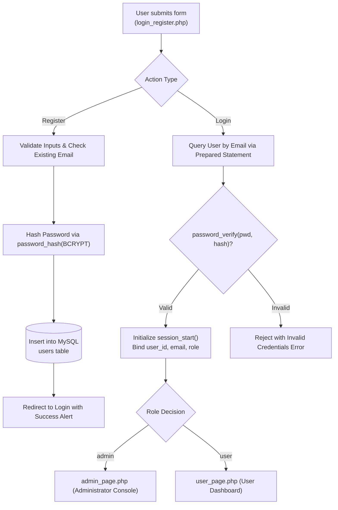
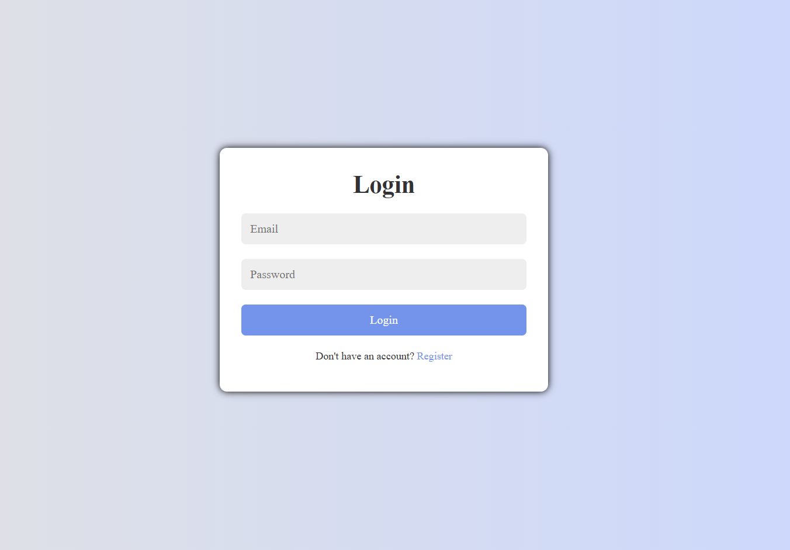
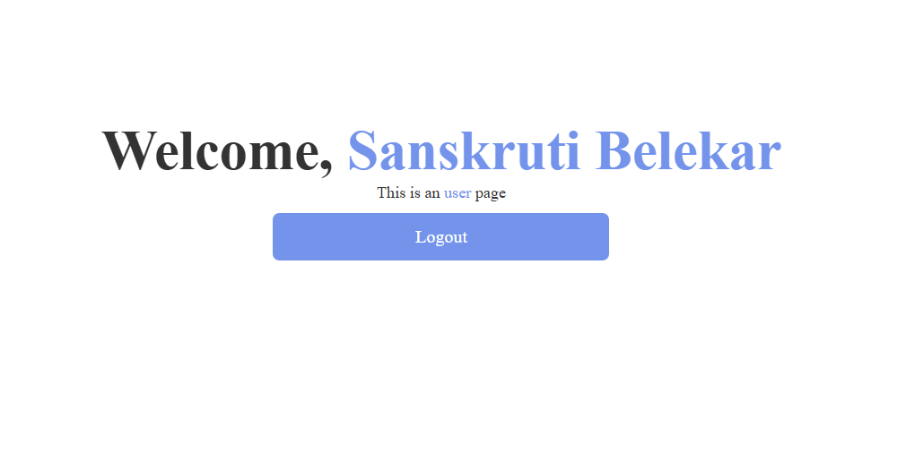
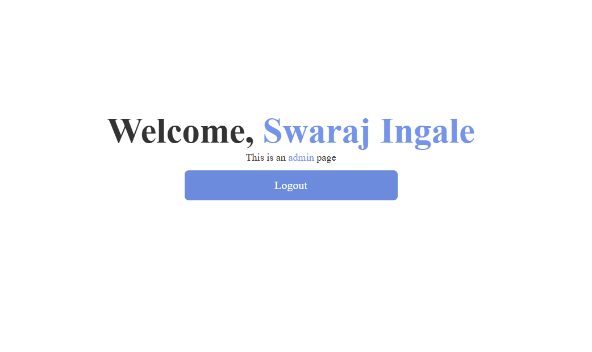

# Secure PHP & MySQL Authentication System

[](https://www.php.net/)
[](https://www.mysql.com/)
[](https://www.php.net/manual/en/function.password-hash.php)
[](LICENSE)

A clean, modular role-based authentication and user registration architecture developed using **PHP**, **MySQL**, **JavaScript**, and **CSS3**. Engineered as a foundational blueprint for secure session management, credential validation, BCrypt password hashing, and role-based redirection (`admin` vs. `user`).

---

## Architecture & Authentication Flow



---

## Key Features

- **Role-Based Access Control (RBAC):** Distinct dashboards for standard users (`user_page.php`) and administrators (`admin_page.php`), protected by session role gates.
- **BCrypt Password Security:** Implements PHP's native `password_hash()` and `password_verify()` with salted BCrypt cost factors, preventing plaintext storage.
- **Interactive Sliding Form UI:** Responsive CSS/JS form switching smoothly between Login and Register views without separate page loads.
- **Session Lifecycle Management:** Hardened session start, session timeout verification, and complete cookie invalidation upon `logout.php`.

---

## Visual Showcase & Screenshots

<div align="center">
  <table>
    <tr>
      <td width="50%" align="center">
        <br/>
        <b>Sign In Interface</b>
      </td>
      <td width="50%" align="center">
        <br/>
        <b>User Registration Interface</b>
      </td>
    </tr>
    <tr>
      <td width="50%" align="center">
        <br/>
        <b>User Dashboard</b>
      </td>
      <td width="50%" align="center">
        <br/>
        <b>Admin Management Console</b>
      </td>
    </tr>
  </table>
</div>

---

## Database Topology

The relational schema is defined in [`database.sql`](database.sql):

```sql
CREATE DATABASE IF NOT EXISTS users_db;
USE users_db;

CREATE TABLE IF NOT EXISTS users (
    id INT AUTO_INCREMENT PRIMARY KEY,
    name VARCHAR(100) NOT NULL,
    email VARCHAR(100) NOT NULL UNIQUE,
    password VARCHAR(255) NOT NULL,
    role VARCHAR(20) NOT NULL DEFAULT 'user'
);
```

---

## Getting Started

### Prerequisites
- PHP 7.4+ or 8.x
- MySQL 5.7+ or 8.0+
- Apache / Nginx (or built-in PHP development server)

### 1. Clone the Repository
```bash
git clone https://github.com/Swaraj0160/php-login-registration-system.git
cd php-login-registration-system
```

### 2. Import Database
Import `database.sql` into your local MySQL server using phpMyAdmin or the MySQL CLI:
```bash
mysql -u root -p < database.sql
```

### 3. Configure Database Connection
Update `config.php` with your local database credentials:
```php
$conn = mysqli_connect('localhost', 'root', 'your_password', 'users_db');
```

### 4. Serve the Application
Using PHP's built-in server:
```bash
php -S localhost:8000
```
Open [http://localhost:8000](http://localhost:8000) in your browser.

---

## Authors & License

- **Developer:** **Swaraj Ingale** ([@Swaraj0160](https://github.com/Swaraj0160))
- **License:** [MIT License](LICENSE)
